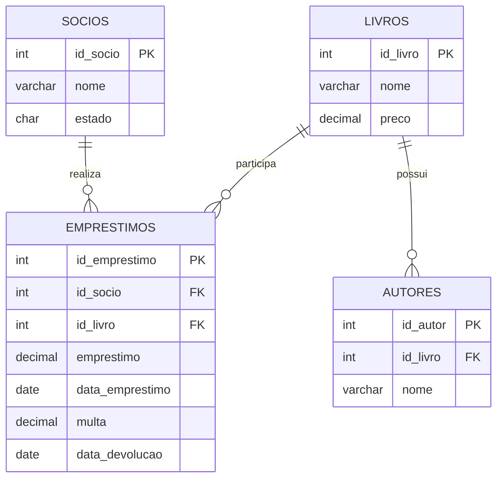

# Biblioteca SQL
### Banco de dados relacional para gerenciamento de sócios, livros e empréstimos

Projeto de modelagem e consulta de dados desenvolvido com **MySQL**, simulando a estrutura de uma biblioteca. O banco organiza informações de sócios, livros, autores e empréstimos, permitindo explorar relacionamentos entre entidades e construir consultas para análise dos dados.

O foco do projeto é aplicar conceitos de bancos de dados relacionais na prática: integridade referencial, operações CRUD, junções, agregações, subconsultas e análise de consultas.

---

## Visão geral

| Informação | Descrição |
|---|---|
| Projeto | Biblioteca SQL |
| Banco de dados | MySQL |
| Linguagem | SQL |
| Ambiente de desenvolvimento | MySQL Workbench |
| Banco criado | `biblioteca_sql_3` |
| Arquivo principal | `index.sql` |

## 1. Problema e objetivo

Uma biblioteca precisa manter o controle de seus livros, autores, sócios e empréstimos. Essas informações possuem relações entre si e precisam estar organizadas de forma que seja possível consultar dados sem duplicar desnecessariamente os registros.

Este projeto propõe uma estrutura relacional para representar esse cenário.

A partir dela, é possível investigar questões como:

- Quais livros estão cadastrados e quais são seus preços?
- Quais sócios possuem registros de empréstimos?
- Quais sócios ainda não possuem empréstimos?
- Quais livros aparecem com maior frequência nos registros?
- Qual é o total de multas registrado?
- Como os empréstimos estão distribuídos entre os estados dos sócios?

**Objetivo técnico:** utilizar SQL para estruturar, manipular e consultar dados, transformando registros distribuídos em informações relacionadas.

## 2. Modelagem do banco de dados

O banco `biblioteca_sql_3` possui quatro entidades principais:

| Entidade | Responsabilidade |
|---|---|
| `socios` | Armazena os dados dos sócios da biblioteca. |
| `livros` | Mantém o catálogo de livros e seus preços. |
| `autores` | Registra os autores associados aos livros. |
| `emprestimos` | Registra os empréstimos, os sócios, os livros, as datas e as multas. |

### Modelo Entidade-Relacionamento (MER)



### Relacionamentos

- **Sócios e empréstimos — 1:N:** um sócio pode possuir vários registros de empréstimos.
- **Livros e empréstimos — 1:N:** um livro pode aparecer em vários registros de empréstimos.
- **Livros e autores — 1:N:** a estrutura atual associa cada registro de autor a um livro por meio de `id_livro`.

O modelo utiliza chaves primárias para identificar registros e chaves estrangeiras para estabelecer os relacionamentos.

> A representação acima descreve a estrutura pretendida pelas referências do SQL. A criação das tabelas precisa respeitar a dependência entre `livros` e `emprestimos`.

## 3. Estrutura do projeto

```text
biblioteca-sql/
│
├── index.sql
└── README.md
```

O arquivo `index.sql` concentra a criação do banco, das tabelas, a inserção dos dados e as consultas utilizadas durante o desenvolvimento.

## 4. Como executar

### Pré-requisitos

- MySQL Server instalado.
- MySQL Workbench ou outro cliente SQL.
- Usuário com permissão para criar bancos e tabelas.

### Executando pelo terminal

Na pasta onde está o arquivo SQL:

```bash
mysql -u root -p < index.sql
```

O comando solicita a senha do usuário `root` e executa o script.

### Executando pelo MySQL Workbench

1. Inicie o MySQL Workbench.
2. Conecte-se ao servidor.
3. Abra o arquivo `index.sql`.
4. Execute o script.
5. Atualize a lista de schemas e localize `biblioteca_sql_3`.

**Observação sobre a execução:** na versão atual, `emprestimos` é criada antes de `livros`, embora possua uma chave estrangeira que referencia essa tabela. Para executar o script em um banco vazio, é necessário criar `livros` antes de `emprestimos`. Também é importante revisar as datas e os registros de teste antes de utilizar os resultados como evidência.

## 5. Consultas e perguntas de negócio

As consultas foram organizadas em diferentes grupos, explorando desde operações básicas até análises relacionais.

### 5.1 Consultas básicas — SELECT

| Consulta | Objetivo | Retorno |
|---|---|---|
| `SELECT * FROM socios` | Consultar os sócios. | Registros cadastrados na tabela. |
| `SELECT * FROM livros WHERE preco >= 30.00` | Encontrar livros a partir de determinado preço. | Livros com preço igual ou superior a R$ 30,00. |
| `ORDER BY preco DESC` | Ordenar os livros por preço. | Livros do maior para o menor preço. |

### 5.2 Relacionamentos — JOIN

Foram exploradas diferentes formas de combinar informações de tabelas relacionadas.

| Recurso | Aplicação | Finalidade |
|---|---|---|
| `INNER JOIN` | Sócios e empréstimos. | Retornar registros que possuem correspondência entre as tabelas. |
| `LEFT JOIN` | Sócios e empréstimos. | Preservar todos os registros da tabela à esquerda, mesmo sem correspondência. |
| `RIGHT JOIN` | Empréstimos e sócios. | Preservar todos os registros da tabela à direita, mesmo sem correspondência. |
| `LEFT JOIN` com `IS NULL` | Livros e empréstimos. | Identificar livros sem correspondência na tabela relacionada. |

A utilização de `JOIN` permite consultar informações que estão distribuídas em entidades diferentes, como identificar o sócio associado a determinado empréstimo.

### 5.3 Funções de agregação

| Função | Aplicação | Informação obtida |
|---|---|---|
| `COUNT()` | Contagem de valores de empréstimos. | Quantidade de valores não nulos. |
| `SUM()` | Soma das multas. | Total dos valores de multa não nulos. |
| `AVG()` | Preço dos livros. | Média dos preços cadastrados. |
| `MAX()` | Preço dos livros. | Maior preço registrado. |
| `MIN()` | Preço dos livros. | Menor preço registrado. |
| `COUNT(DISTINCT)` | Valores de empréstimos distintos. | Quantidade de valores diferentes, sem repetição. |

### 5.4 Agrupamento — GROUP BY e HAVING

O projeto também explora agrupamentos para organizar os dados por categorias.

Uma das consultas agrupa os registros por estado e utiliza:

```sql
GROUP BY c.estado
HAVING COUNT(*) > 2;
```

A intenção é identificar grupos que possuam mais de dois registros.

`GROUP BY` reúne registros que compartilham um mesmo valor. `HAVING` permite filtrar os grupos depois da agregação.

### 5.5 Consultas avançadas

| Recurso | Pergunta investigada | Resultado esperado |
|---|---|---|
| Subconsulta com `AVG()` | Quais livros possuem preço acima da média? | Livros cujo preço supera a média geral. |
| `IN` | Quais sócios aparecem nos registros de empréstimos? | Sócios com IDs presentes na subconsulta. |
| `NOT EXISTS` | Quais sócios não possuem empréstimos? | Sócios sem registros correspondentes. |
| `EXISTS` | Quais sócios possuem pelo menos um empréstimo? | Sócios para os quais existe um registro relacionado. |
| `DISTINCT` | Quais sócios aparecem sem repetição? | Registros únicos conforme as colunas selecionadas. |
| `EXPLAIN` | Como o MySQL pretende executar uma consulta? | Plano de execução da instrução analisada. |

### 5.6 Consultas de cenário

O arquivo também contém três consultas voltadas à construção de relatórios:

**Relatório de multas**

Utiliza `SUM()` e `COALESCE()` para trabalhar com valores de multas e substituir resultados nulos por zero.

**Ranking de livros**

Relaciona livros e empréstimos, conta os registros associados a cada livro, ordena pela quantidade e limita o resultado aos três primeiros.

**Cruzamento de dados**

Agrupa informações por sócio e utiliza contagem distinta de empréstimos e soma de multas para construir uma visão conjunta.

> As consultas de relacionamento e relatórios ainda precisam de revisão nas condições dos `JOIN`. A documentação descreve a finalidade pretendida, mas os resultados não devem ser considerados validados até que as condições utilizem as chaves estrangeiras corretas.

## 6. Conceitos aplicados

### PK e FK — integridade referencial

**Primary Key (PK)** é a chave primária. Sua função é identificar cada registro de forma única dentro de uma tabela.

Exemplo: `id_socio` identifica cada sócio.

**Foreign Key (FK)** é a chave estrangeira. Ela estabelece uma referência entre tabelas, conectando um registro ao identificador de outra entidade.

Exemplo: `id_socio` em `emprestimos` referencia `id_socio` em `socios`.

Essa estrutura permite manter os relacionamentos entre os dados e ajuda a impedir referências a registros inexistentes.

### Por que utilizar JOIN?

As informações não precisam ficar concentradas em uma única tabela. Cada entidade possui sua própria responsabilidade.

O `JOIN` permite reunir informações relacionadas no momento da consulta.

Por exemplo, para apresentar o nome de um sócio junto aos dados de seu empréstimo, é necessário relacionar `socios` e `emprestimos`.

### GROUP BY e HAVING

O `GROUP BY` organiza registros em grupos para permitir cálculos sobre cada conjunto.

O `HAVING` filtra esses grupos utilizando condições que podem envolver funções de agregação.

Já o `WHERE` filtra registros antes do agrupamento.

### Transações

A versão atual do arquivo não contém comandos explícitos de transação, como:

```sql
START TRANSACTION;

-- Operações SQL

COMMIT;
-- ou ROLLBACK;
```

Por isso, a implementação de transações ainda não está concluída.

Em uma evolução do projeto, elas podem ser utilizadas para garantir que operações relacionadas sejam confirmadas em conjunto ou desfeitas em caso de falha.

### EXPLAIN — análise de execução

O projeto possui uma consulta com `EXPLAIN`:

```sql
EXPLAIN
SELECT
    m.id_emprestimo,
    m.emprestimo
FROM emprestimos m
WHERE m.id_socio = m.id_emprestimo;
```

O `EXPLAIN` apresenta informações sobre o plano de execução escolhido pelo MySQL, como o tipo de acesso, as tabelas examinadas e os índices considerados.

O resultado dessa execução ainda precisa ser registrado e analisado. Além disso, a condição utilizada compara duas colunas de identificação diferentes e deve ser revisada antes de utilizar essa consulta como exemplo de análise de desempenho.

## 7. Operações CRUD

O projeto contempla exemplos das quatro operações fundamentais de manipulação de dados:

| Operação | Comando | Utilização |
|---|---|---|
| Create | `INSERT` | Inserção de novos sócios, livros e autores. |
| Read | `SELECT` | Consulta e leitura dos registros. |
| Update | `UPDATE` | Alteração de informações existentes. |
| Delete | `DELETE` | Remoção de registros. |

Essas operações permitem trabalhar com o ciclo básico de manutenção das informações armazenadas no banco.

## 8. Tecnologias e ferramentas

- **MySQL:** gerenciamento do banco de dados relacional.
- **SQL:** definição, manipulação e consulta dos dados.
- **MySQL Workbench:** ambiente utilizado para desenvolvimento e execução das consultas.

---

## Autor

Desenvolvido como projeto prático de estudos em Banco de Dados, com foco em modelagem relacional, SQL e análise de informações.

**GitHub:** [kayolindo58](https://github.com/kayolindo58)
